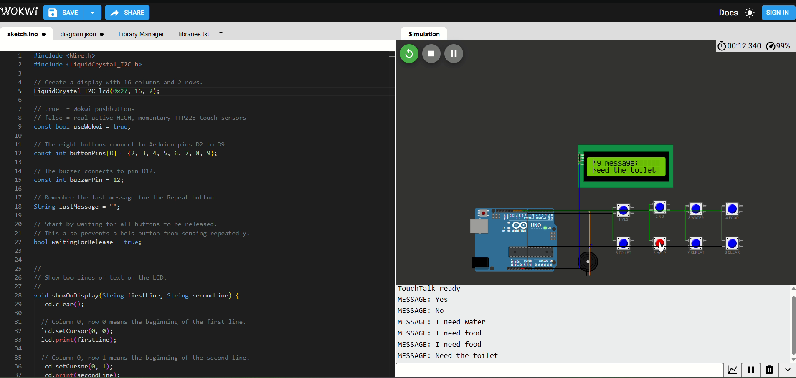
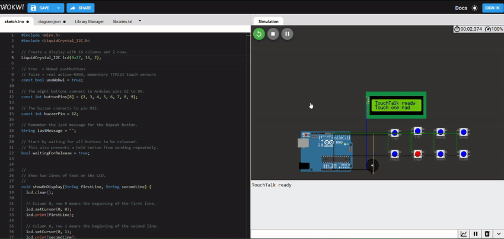
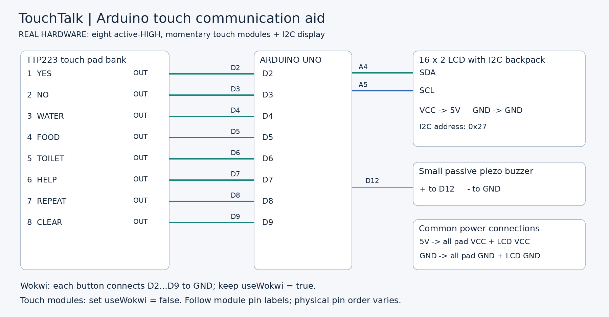

# TouchTalk — Arduino Touch-to-Message Aid

A beginner-friendly Arduino project that turns a button press or touch-sensor input into a short message on a 16×2 LCD. Eight inputs provide six everyday phrases, Repeat, and Clear, with buzzer feedback.

**No Arduino? You can run the project in your browser using Wokwi.** No physical board, sensors, wiring, or Arduino IDE are needed for the simulation.

[Start a new Wokwi project](https://wokwi.com/projects/new/arduino-uno) · [Watch/download the demo video](assets/wokwi-demo.mp4) · [Circuit diagram](assets/circuit-diagram.png)

## Preview

Actual Wokwi screenshot extracted from the supplied demonstration video:



### Animated demonstration

[](assets/wokwi-demo.mp4)

**[Open the full demo video — MP4, about 14 seconds](assets/wokwi-demo.mp4)**

The GIF plays directly in the README. The original MP4 is included in the repository; use the link to open it, or download it if GitHub shows a file page instead of a player. The video is preserved unchanged.

## What the project does

- Displays six fixed phrases on an I2C LCD.
- Prints the same messages in Serial Monitor.
- Beeps when a message is selected, with a longer Help beep.
- Repeats the last message or clears it.
- Requires all inputs to be released between actions.
- Rejects multiple inputs detected together.
- Uses short functions, comments and straightforward `if / else` statements.

This is a fixed-phrase communication prototype, not a sign-language translator or a Braille keyboard. It may be useful for someone who prefers tactile input, including a blind person who also needs communication assistance. Blindness itself does not imply an inability to speak. The LCD is for the communication partner; raised labels help a user locate inputs. The buzzer acknowledges actions but does not speak the selected phrase.

## Run without an Arduino — Wokwi

### 1. Get the files

On GitHub, select **Code → Download ZIP**, then extract it. If you already have this project ZIP, simply extract it.

### 2. Create the simulation

Open **https://wokwi.com/projects/new/arduino-uno** on a computer browser. This is a new-project page, not a saved TouchTalk simulation link.

### 3. Paste the Arduino code

1. Open the downloaded `sketch.ino` with Notepad or another text editor.
2. Copy its complete contents.
3. In Wokwi, click the **sketch.ino** tab.
4. Select all the starter code and replace it with the copied code.

Keep this setting:

```cpp
const bool useWokwi = true;
```

### 4. Load the complete circuit

1. Open the downloaded `diagram.json` in a text editor and copy all its contents.
2. Click Wokwi's **diagram.json** tab.
3. Replace the entire existing JSON with the downloaded contents.

The Uno, LCD, buzzer, eight buttons and connecting wires should appear automatically. You do not need to place each part by hand.

### 5. Add the display library

Open **Library Manager**, press **+**, search for **LiquidCrystal I2C**, and add it. Alternatively, create `libraries.txt` from the editor's file menu and paste the included file contents:

```text
LiquidCrystal I2C
```

`Wire.h` is supplied with the Arduino core; no separate installation is required for it.

### 6. Start and interact

Click the green **▶ Start simulation** button. After startup, the screen shows:

```text
TouchTalk ready
Touch one pad
```

Click and briefly hold a button, then release it. With the circuit area focused, keyboard keys **1–8** select the same inputs. Hold and release for roughly 0.1 seconds each at normal simulation speed; a slow browser may need longer.

| Button / key | Arduino pin | LCD action |
|---|---|---|
| 1 — YES | D2 | Yes |
| 2 — NO | D3 | No |
| 3 — WATER | D4 | I need water |
| 4 — FOOD | D5 | I need food |
| 5 — TOILET | D6 | Need the toilet |
| 6 — HELP | D7 | Please help me |
| 7 — REPEAT | D8 | Repeat the previous message |
| 8 — CLEAR | D9 | Forget the previous message and return to ready |

**Example:** choose **3 WATER**. The LCD shows `My message:` / `I need water`, while Serial Monitor shows:

```text
MESSAGE: I need water
```

Select **7 REPEAT** to send it again. Select **8 CLEAR**, then **7 REPEAT**: the display shows `No message yet`.

Wokwi pushbuttons represent the digital outputs of touch modules. This tests the program and simulated circuit, not real capacitive sensitivity. Audio output consists of buzzer tones, not speech.

### 7. Save your own simulation

Use Wokwi's **Save** button and follow its current account/privacy prompts. After saving, copy your project URL into this README if you want visitors to open your assembled simulation directly. No permanent Wokwi project URL is included in this package.

## How the code works

| Code | Purpose |
|---|---|
| `setup()` | Initializes the input pins, LCD, Serial Monitor and buzzer once |
| `loop()` | Repeatedly checks inputs and selects an action |
| `readButtons()` | Returns 0 for none, 1–8 for one input, or −1 for multiple inputs |
| `showOnDisplay()` | Prints two lines on the LCD |
| `sendMessage()` | Remembers and displays the phrase, logs it and beeps |
| `lastMessage` | Stores the phrase used by Repeat |
| `waitingForRelease` | Prevents a held input from repeatedly sending |
| `delay(40)` | Separates two readings for a simple debounce check |

To follow the Water example: `readButtons()` returns `3`, `loop()` enters `else if (button == 3)`, and `sendMessage("I need water")` updates the outputs.

The debounce method is intentionally simple and blocking: it compares two readings 40 ms apart. It does not prove the signal was stable throughout that interval. Very short presses can be ignored; an action already sent cannot be undone by a later second touch.

## Build with real hardware

You need an Arduino Uno, eight active-HIGH **momentary** TTP223 touch modules, a 16×2 LCD with I2C backpack, a small low-current passive piezo buzzer, breadboard, jumper wires and a USB cable.



| Part connection | Destination |
|---|---|
| Touch-module OUT pins 1–8 | D2–D9 respectively |
| All touch-module VCC pins | 5V |
| All touch-module GND pins | GND |
| LCD VCC / GND | 5V / GND |
| LCD SDA / SCL | A4 / A5 |
| Piezo + / − | D12 / GND |

1. Disconnect power before wiring. Follow each module's printed pin labels; physical pin order varies.
2. Verify the sensors output LOW at rest and HIGH while touched. Use momentary mode, not toggle mode.
3. Change `const bool useWokwi = true;` to `const bool useWokwi = false;`.
4. For Arduino IDE, create a separate folder named `TouchTalk`, copy `sketch.ino` into it as `TouchTalk.ino`, and open that file. Keep only one `.ino` copy in that folder.
5. Install **LiquidCrystal I2C** by Frank de Brabander, choose **Arduino Uno** and the connected board's port, then upload.
6. Leave sensors untouched while powering on so they can calibrate.

For physical pushbuttons wired to GND instead of touch modules, keep `useWokwi = true`; that mode also works with real active-low buttons.

Choose raised labels or Braille labels with the intended user. Place labels beside active touch areas, add a clear orientation marker, and leave enough space between pads. Touch sends immediately after the simple debounce check; there is no preview/confirm stage. Actual usability and accidental activation need testing with the user.

This beginner version contains **no DFPlayer, MP3 playback, speech recognition or text-to-speech**. HELP only displays a local message and beeps; it does not call or alert anyone remotely. It is not a sole emergency communication system and does not provide tactile output for deafblind users.

## Troubleshooting

| Problem | Check |
|---|---|
| `LiquidCrystal_I2C.h: No such file` | Add **LiquidCrystal I2C** in Library Manager |
| Only an Uno appears | Replace the complete `diagram.json`, not only `sketch.ino` |
| A quick click does nothing | Hold longer, then release all inputs; wait for startup to finish |
| Simulation is slow | Watch simulated time; Ctrl-click (Cmd-click on macOS) can hold a button, and another click releases it |
| Circuit is outside the visible area | Use the circuit menu's **Fit** option |
| LCD is blank on hardware | Check power, contrast, SDA/SCL and the backpack's I2C address; code uses `0x27` |
| Touch sensor response is reversed | Check `useWokwi = false` and active-HIGH momentary module configuration |
| No spoken words | Expected: this version only produces tones |
| Wokwi rejects an uploaded file | Starter filenames already exist; replace their text instead |

## Files

| File | Purpose |
|---|---|
| `sketch.ino` | Beginner-friendly Arduino program |
| `diagram.json` | Complete Wokwi circuit |
| `libraries.txt` | Display-library dependency |
| `assets/wokwi-preview.png` | Screenshot from the supplied demo |
| `assets/wokwi-demo.gif` | README animation derived from the demo |
| `assets/wokwi-demo.mp4` | Original supplied video, unchanged |
| `assets/circuit-diagram.png` | Pin-level wiring diagram for this version |
| `docs/GITHUB_SETUP.md` | Publishing instructions |
| `docs/TESTING.md` | Evidence, checks and limitations |

## Validation

The supplied video shows the beginner sketch running in Wokwi with phrase output in Serial Monitor. The preview is extracted from that recording. See [testing notes](docs/TESTING.md) for separately checked code behavior and remaining physical-hardware checks.

## References

- [Wokwi button reference](https://docs.wokwi.com/parts/wokwi-pushbutton)
- [Wokwi I2C LCD reference](https://docs.wokwi.com/parts/wokwi-lcd1602)
- [Wokwi diagram format](https://docs.wokwi.com/diagram-format)

## Author

Ankit Kumar Panda
